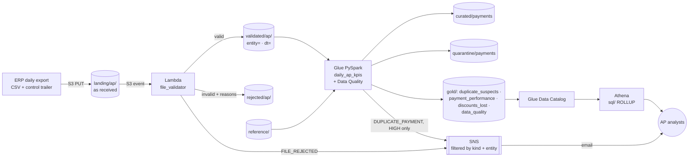
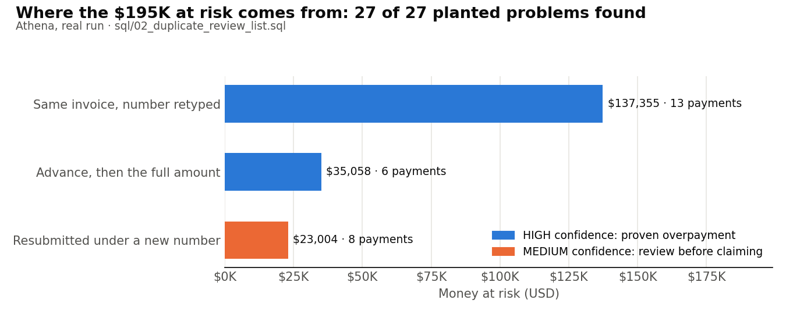
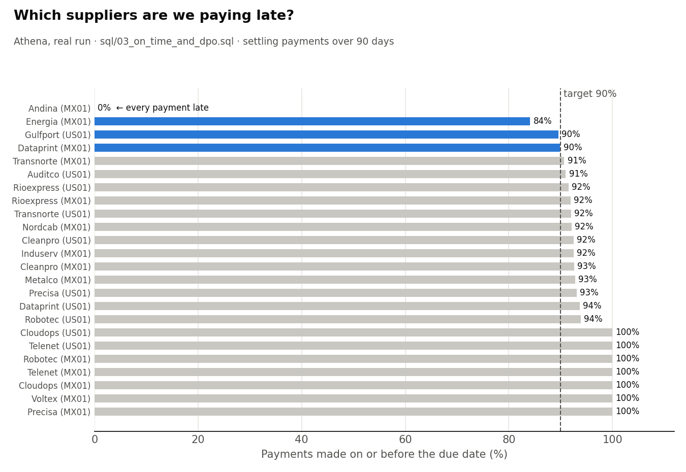
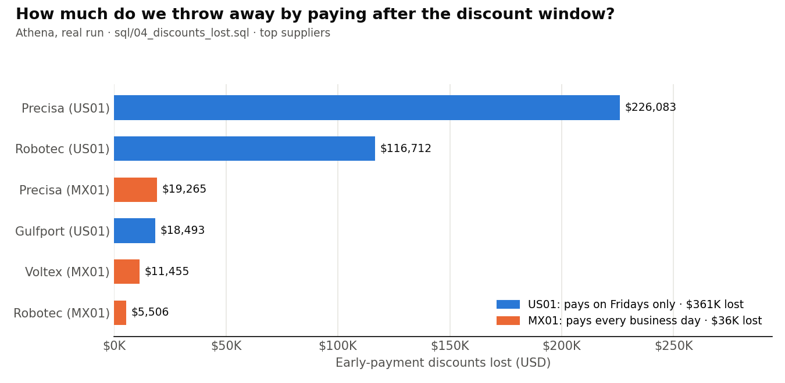
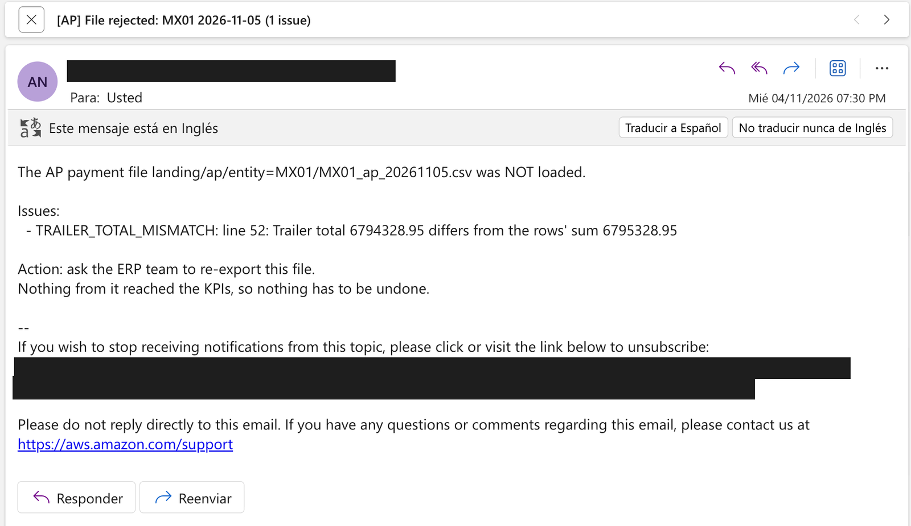
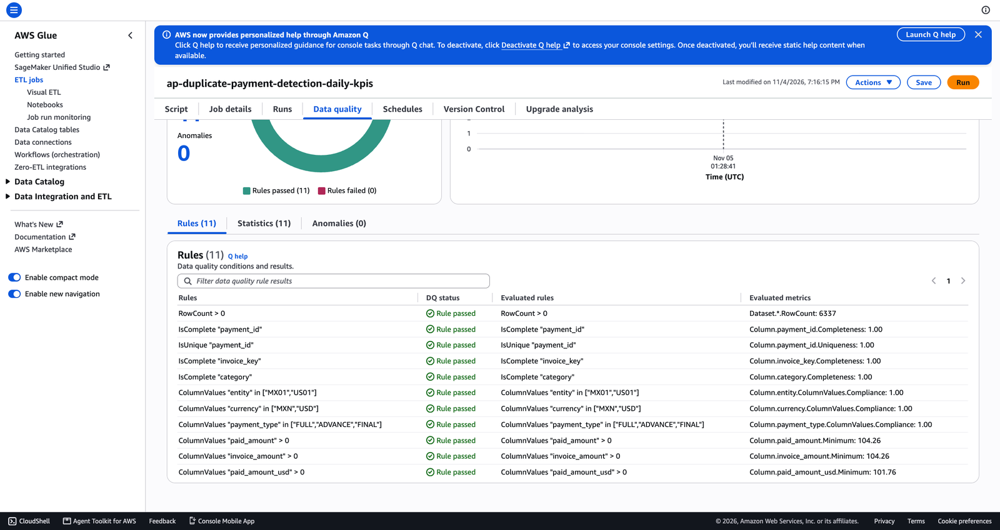
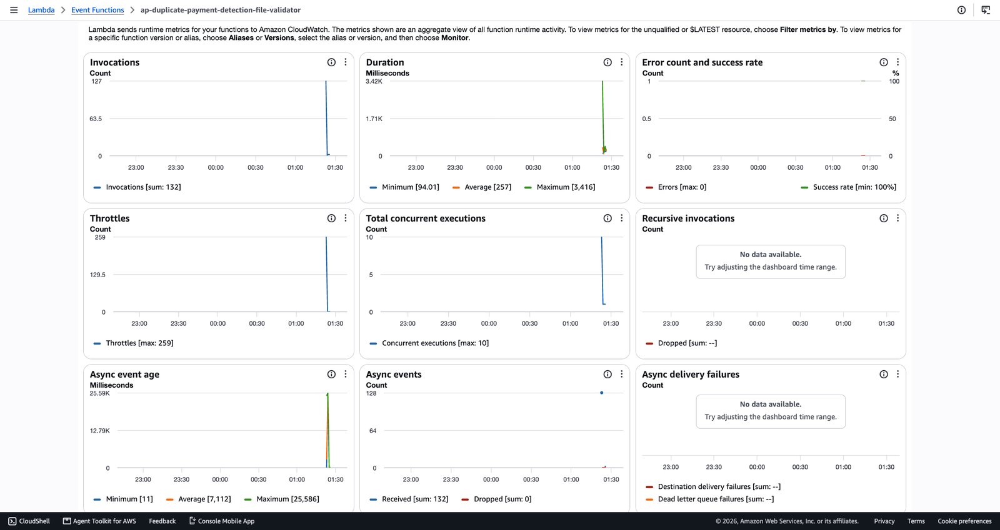

# Stop paying the same supplier invoice twice

A file-driven AWS pipeline for accounts payable. It checks every ERP payment file the moment it lands, finds **duplicate payments** (even when the invoice number was typed differently or resubmitted under a new one), and reports **on-time payment, DPO and early-payment discounts lost** by entity, supplier category and supplier.


  

> ✅ **Deployed for real on AWS, then destroyed.** 30 resources ran for 29 minutes, with a live demo: a hand-edited file rejected in seconds, a re-sent file ignored, and every planted duplicate found (27 of 27). Second project of the portfolio, after [manufacturing-scrap-and-stockout-alerts](https://github.com/ethanverper/manufacturing-scrap-and-stockout-alerts): the same company, now seen from finance.
>
> 📸 **[See the evidence: 14 console screenshots in process order, the deploy log, and the raw CLI output →](docs/evidence/README.md)**

## Progress

| Level | What | Status |
|---|---|---|
| 0 | Business case, KPIs, planted data story, design, cost estimate ([docs/spec.md](docs/spec.md)) | ✅ Done |
| 1 | ERP simulator: 2 entities (MX/US), 16 suppliers, 90 days of daily payment files with control trailers, and the planted problems with an answer key | ✅ Done |
| 2 | File validation Lambda: control trailer, header contract, row structure, entity/day consistency; re-sent files are idempotent; refused files are quarantined with reasons and AP is emailed | ✅ Done |
| 3 | Duplicate detection with confidence tiers + payment KPIs (PySpark), **graded against the answer key: 26/26 found, 0 false alarms** | ✅ Done |
| 4 | Terraform (30 resources): S3 event → Lambda, Glue job + **Glue Data Quality** (DQDL), duplicate emails by entity, 5 Athena queries with `ROLLUP` (tested on local Spark) | ✅ Done |
| 5 | Real deploy with a live demo, evidence, two lessons from AWS, teardown verified ([deploy log](docs/evidence/deploy-log.md)). Actual cost pending (Cost Explorer lags ~24 h). | ✅ Done |

## 1. The business problem

Accounts payable pays thousands of supplier invoices a month, mostly keyed in by people. The same invoice gets paid twice in three common ways:
- it is typed again with a different number format (`FAC-0457` vs `fac 457`);
- the supplier resends it under a new number;
- an advance is paid and then the full amount anyway.

These errors are usually found months later, by an audit or a recovery firm. Separately, payment runs scheduled for the convenience of the calendar quietly throw away early-payment discounts worth ~37% a year.

**Who uses it:**
- AP analyst: stops or recovers a duplicate;
- Controller: fixes the process;
- Treasury: schedules payment runs;
- Procurement: talks to the suppliers.

## 2. KPIs

| KPI | Formula | Hierarchy | Alert | Frequency |
|---|---|---|---|---|
| **$ at risk from duplicate payments** | Amount paid in excess on suspected duplicates (USD) | Entity → Supplier category → Supplier → Invoice | High confidence → email AP the same day | Daily |
| **On-time payment %** | Paid by the due date ÷ all payments | Entity → Supplier category → Supplier | < 90% highlighted | Daily |
| **DPO** | Amount-weighted days from invoice to payment | Entity → Supplier category → Supplier | Report vs terms | Daily |
| **Early-payment discounts lost ($)** | Discount % × amount, for discount-term invoices paid after the window | Entity → Supplier category → Supplier → Invoice | Monthly total to Treasury | Daily |

## 3. Architecture and data lineage



Every number can be traced back to the exact ERP file and line it came from:

`landing/` (bytes as received) → `validated/` (same bytes + SHA-256) → `curated/` (one row per real payment) → `gold/` (one table per KPI) → Athena.

| Service | Role | Why this one and not the alternative |
|---|---|---|
| **S3 event → Lambda** | Checks every file in seconds as it lands | A daily file needs no stream (no Kinesis, nothing billed by the hour), and Glue takes ~1–2 min just to start |
| **Glue (PySpark)** | Row rules, duplicate detection, KPIs over all 90 days | Joins and windows over every payment; serverless Spark, paid per minute |
| **Glue Data Quality** | A versioned DQDL ruleset on the curated table | Declared, tested rules with results in the console, instead of ad-hoc checks |
| **Glue Data Catalog + Athena** | The analysts' SQL access to `gold/` | No database server running; $5 per TB scanned, capped at 1 GB per query |
| **SNS** | Rejected-file and duplicate-payment emails, filtered per person | One topic, filter policies by `kind` and `entity` |
| **Terraform** | All 30 resources from `config/settings.yaml` | Reproducible, and destroyed with one command |

Full diagrams (data lineage, one file step by step), components, storage layout and security: **[docs/architecture.md](docs/architecture.md)** · design decisions: [docs/decisions.md](docs/decisions.md)

## 4. The data

The simulated ERP exports one CSV per entity per business day. **Its last line is a control trailer** with the record count and the total paid, the way bank and ERP files prove they arrived complete. 90 days, 2 entities, 6,322 payments, about $60M paid. Planted in it, with an answer key the pipeline will be graded against:

| Problem | Where | Count | $ at risk (USD) |
|---|---|---|---|
| Same invoice paid twice, number typed differently | Mexico | 12 | $115K |
| Invoice resubmitted by the supplier under a new number | US, a freight carrier | 8 | $23K |
| Advance paid, then the full amount anyway | Both | 6 | $21K |
| Payment runs only on Fridays, scheduled to due dates | US | all discount invoices | $369K of discounts lost |
| One supplier always paid late | Mexico | all its invoices | 0% on time |

There are also traps the detector must **not** fall into:
- monthly subscriptions that bill the same amount every month;
- dozens of legitimate advance + final payments.

## 5. What the data shows (real run on AWS)

All numbers below come from Athena on the real deploy (`docs/images/results/`). The charts are drawn from those results by `scripts/make_charts.py`.



| Planted problem | Planted | Found | Rule | Confidence | $ at risk |
|---|---|---|---|---|---|
| Same invoice, number retyped (incl. the live demo's) | 13 | **13** | `SAME_INVOICE_RETYPED_NUMBER` | HIGH | $137,355 |
| Advance, then the full amount | 6 | **6** | `ADVANCE_THEN_FULL_AMOUNT` | HIGH | $35,058 |
| Resubmitted under a new number | 8 | **8** | `RESUBMITTED_UNDER_NEW_NUMBER` | MEDIUM | $23,004 |
| **Total** | **27** | **27** | | | **$195,416** |

**Precision 100%, recall 100%**, graded against an answer key the pipeline never sees. The legitimate look-alikes raise no alarm: dozens of advance + final payments, and monthly subscriptions. One rule, "total paid > invoice amount" on a normalized invoice number, catches both HIGH problems and can never flag a legitimate advance (ADR-005).

**Lesson learned:** a test widening the resubmission window to 31 days raised two kinds of false alarm: the subscriptions, and **two different freight invoices of exactly $4,700.22**, a chance match. Same-amount matching stays MEDIUM confidence with a 7-day window ([lesson 1](docs/lessons-learned.md), ADR-006).





| Payment KPI (90 days, $58.5M paid) | MX01 | US01 |
|---|---|---|
| On-time payment % | 85.0% (SUP-ANDINA: **0%**) | 92.1% |
| DPO (amount-weighted days) | 20.7 | 30.0 |
| Early-payment discounts lost | $36,226 (94 invoices) | **$361,287** (1,041 invoices) |

**What each team would do:**
- **AP:** recover the 19 proven overpayments ($172K), review the 8 resubmissions ($23K), and fix manual invoice entry (13 retyped numbers).
- **Procurement:** talk to SUP-ANDINA, which has never been paid on time.
- **Treasury:** add a mid-week payment run in US01. Paying on Fridays only throws away $361K of discounts in 90 days, ten times MX01's loss, mostly with SUP-PRECISA and SUP-ROBOTEC.

## 6. The real run on AWS

| | |
|---|---|
| **History load** | 128 ERP files → 128 Lambda validations → **128 validated, 0 rejected, 0 errors** |
| **Live demo** | Hand-edited file **rejected in seconds** (`TRAILER_TOTAL_MISMATCH`: exactly the $1,000 added) + email to AP Mexico · correct file validated · same file re-sent → ignored |
| **Daily Glue job** | SUCCEEDED in 2 min 44 s · 6,337 rows reconciled · **Glue Data Quality 11/11 rules passed** |
| **Detector on Athena** | **27 of 27 planted problems found, 0 false alarms**, $195,416 at risk (graded against the answer key) |
| **Teardown** | `30 destroyed`, empty state, `make leftovers` → ✅ Nothing billable left |
| **Evidence** | **[All evidence, explained step by step](docs/evidence/README.md)** · [deploy log](docs/evidence/deploy-log.md) · [Athena results](docs/images/results/) |

| A hand-edited file, rejected in seconds | Glue Data Quality: 11/11 rules | 10 concurrent Lambdas, 259 throttles, 0 lost |
|---|---|---|
|  |  |  |

**What AWS taught us** ([lessons 2 and 3](docs/lessons-learned.md)):
- **The account allows only 10 concurrent Lambdas.** Loading 128 files caused 259 throttles and **lost nothing**, because S3 invokes Lambda asynchronously and throttled events are retried automatically. A synchronous caller would have received errors.
- **One alert email never arrived.** SNS reported no failure, and a re-publish of the same content arrived. Email is a notification, not a record: the duplicate was always in the Athena review list, the source of truth. In production, a durable SQS subscriber would back the email.

## 7. Run it

Setup and every configuration value: [docs/configuration.md](docs/configuration.md)

```bash
make install && make test   # unit tests + the Lambda against simulated AWS (moto), no AWS account needed
make generate               # 90 days of ERP files + master data + answer key into data/generated/
make kpis-local             # the Glue job (duplicates + KPIs) with a local Spark
make grade                  # precision and recall against the answer key
```

**On AWS, from scratch** (the real run took 29 minutes; nothing bills by the hour; everything is deleted at the end):
1. An AWS account with MFA on the root user and a budget alert; a working identity (`aws sts get-caller-identity`); AWS CLI v2, Terraform ≥ 1.6, Python ≥ 3.10, Java 17.
2. `cp config/subscribers.example.yaml config/subscribers.yaml` and put in the emails that should receive the AP alerts.
3. `make generate-demo` → `make deploy` (confirm the subscription emails) → `make upload-reference` → `make upload-history` → `make demo` → `make kpis` → `make queries`.
4. Tear down: `make destroy` → `make clean-glue-logs` → `make leftovers` (it must print `✅ Nothing billable left.`).

The step-by-step record of a real run: [docs/evidence/deploy-log.md](docs/evidence/deploy-log.md).

## Repository layout

```
config/            settings.yaml (every tunable value) · master_data.yaml (entities, suppliers, terms) · subscribers.example.yaml
dq/                curated_payments.dqdl (Glue Data Quality ruleset)
infra/terraform/   one numbered file per stage: ingestion, batch, alerts, analytics
sql/               one query per business question (ROLLUP), runs on Athena and Spark
docs/              spec, architecture, KPI dictionary, design decisions, lessons learned, configuration, coding standards
src/
  common/          the file contract (schema), settings, config, logging, AWS clients
  generators/      reference (master data, payment terms) · story (planted problems) · simulator · files · history
  lambdas/         file_validator: validation (pure checks) · storage (S3 zones) · notifier (SNS) · handler
  glue_jobs/       daily_ap_kpis (extract → transform → reconcile → quality → load → alert) · transforms (pure PySpark) · data_quality · alerts
  evaluation/      grading: the detector against the answer key
scripts/           kpis_local · grade_detection · demo · run_queries · make_charts · evidence · leftovers · clean_glue_logs · cost
  (src/analytics/ runs the sql/ queries on Athena)
tests/             unit tests, moto-backed tests of the Lambda, and local-Spark tests of the Glue job
```

Code standards: modular, typed, commented at every step. See [docs/CODING_STANDARDS.md](docs/CODING_STANDARDS.md).
