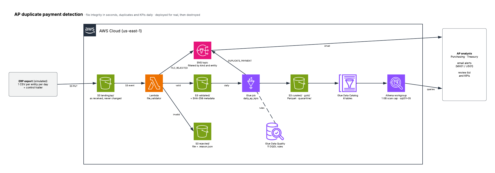
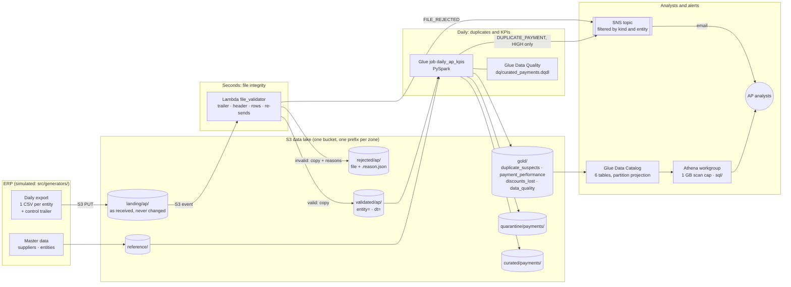
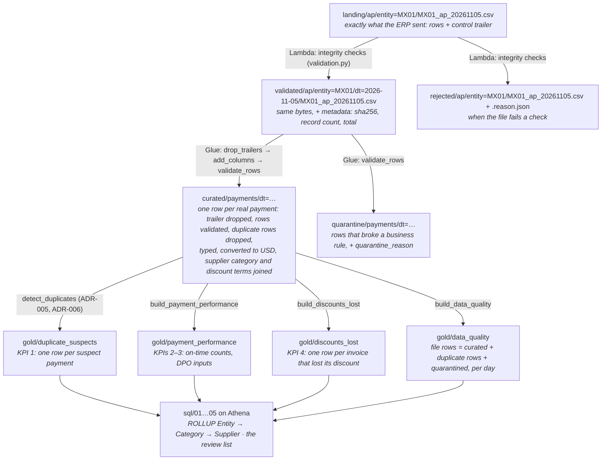
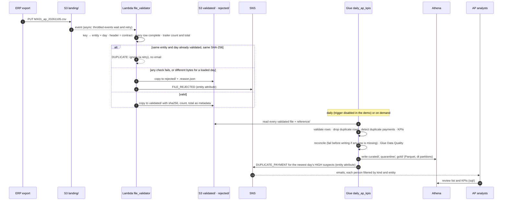

# Architecture

## 1. The big picture



<sub>Drawn in Lucidchart with the official AWS 2024 icon set. The Mermaid version below is the same flow as text, kept next to the code so it changes with it.</sub>

Two speeds, one source of files:

| Speed | Question it answers | Path |
|---|---|---|
| **Seconds** | "Did today's ERP file arrive complete and untouched?" | S3 event → Lambda `file_validator` → `validated/` or `rejected/` + email |
| **Daily** | "Did we pay any invoice twice? Are we paying on time, and losing discounts?" | `validated/` → Glue job `daily_ap_kpis` → `curated/` + `gold/` → Athena · email for proven duplicates |



## 2. Data lineage: where every number comes from

Each zone is produced by one component from the zone before it, so any KPI can be traced back to the exact ERP file and line it came from.



**Tracing one duplicate back to its source:**
1. `gold/duplicate_suspects`: `suspect_payment_id = PAY-MX01-003650`, rule `SAME_INVOICE_RETYPED_NUMBER`.
2. `curated/payments`: the row with that id shows `supplier_invoice_number = "rx 938"`, `invoice_key = RX938`.
3. `validated/ap/entity=MX01/dt=2026-11-05/MX01_ap_20261105.csv`: the line of that payment, exactly as exported.
4. `landing/ap/…`: the identical file as received. Its SHA-256 in the validated copy's metadata proves it is the same.

## 3. One file, then one day, step by step



## 4. Components

| Component | Code | Responsibility |
|---|---|---|
| ERP simulator | `src/generators/` | 90 days of daily files with control trailers, planted problems, the demo day, the answer key |
| File validator (Lambda) | `src/lambdas/file_validator/` | `validation.py` pure checks · `storage.py` S3 zones · `notifier.py` email · `handler.py` decision |
| Daily job (Glue, PySpark) | `src/glue_jobs/` | `transforms.py` pure rules, detection and KPIs · `data_quality.py` DQDL evaluation · `alerts.py` duplicate email · `daily_ap_kpis.py` extract → transform → reconcile → quality → load → alert |
| Data Quality ruleset | `dq/curated_payments.dqdl` | 11 table-level rules, tested against the file contract |
| Queries | `sql/01…05` | ROLLUP KPIs and the review list, portable between Athena and Spark |
| Grading | `src/evaluation/grading.py` | Precision and recall of the detector against the answer key |
| Infrastructure | `infra/terraform/` | `1_ingestion.tf` S3 event + Lambda · `2_batch.tf` Glue + DQ · `3_alerts.tf` SNS · `4_analytics.tf` catalog + workgroup |

## 5. Storage layout

```
s3://ap-duplicate-payment-detection-<account>/
├── landing/ap/entity=<E>/<E>_ap_<YYYYMMDD>.csv          as received (audit trail; never changed)
├── validated/ap/entity=<E>/dt=<YYYY-MM-DD>/<file>       passed every check (+ sha256 metadata)
├── rejected/ap/entity=<E>/<file> + <file>.reason.json   failed a check, with the reasons
├── reference/suppliers/ · reference/entities/            master data
├── curated/payments/dt=<YYYY-MM-DD>/*.parquet            one row per real payment
├── quarantine/payments/dt=<YYYY-MM-DD>/*.parquet         rows that broke a business rule
├── gold/duplicate_suspects/ · payment_performance/ · discounts_lost/ · data_quality/
├── scripts/                                              the Glue script, its modules, the DQDL ruleset
└── athena-results/                                       query results (expire after 7 days)
```

## 6. Security

- **One IAM role per component**, least privilege:
  - the Lambda reads `landing/`, writes `validated/` and `rejected/`, and publishes to one topic;
  - Glue reads `validated/`, `reference/` and `scripts/`, writes `curated/`, `quarantine/` and `gold/` (plus their folder markers), and publishes to the topic and to Data Quality.
- **S3 trigger scoped** to `landing/ap/*.csv` and to this bucket and account (the Lambda's resource policy).
- **Encryption:** S3 at rest (AES-256), HTTPS required by bucket policy, no public access. No customer-managed KMS keys.
- **No personal data in the repo:** email addresses live in the gitignored `config/subscribers.yaml`; evidence is redacted.
