# Evidence: the real run on AWS

This project was deployed for real on **2026-11-05**: 30 AWS resources, 29 minutes, then destroyed and verified clean. Everything below comes from that run. Screenshots are cropped and redacted so no account id, email address or personal detail appears.

| What | Where |
|---|---|
| Step-by-step record: timeline, results, what went differently, cost, teardown | [deploy-log.md](deploy-log.md) |
| Console screenshots, in the order of the process | below |
| Raw CLI output of every check (account id and emails replaced with placeholders) | [deployed/](deployed/) · [loaded/](loaded/) · [demo/](demo/) · [batch/](batch/) · [destroyed/](destroyed/) |
| The five Athena queries' results, as CSV | [../images/results/](../images/results/) |

---

## 1. The infrastructure exists

**The S3 → Lambda trigger.** Every new `.csv` under `landing/ap/` invokes the file validator. The prefix filter is also what keeps the Lambda from triggering itself when it copies files.
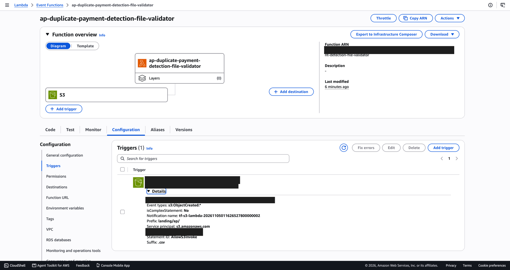

**The bucket before any data:** only the master data (`reference/`) and the job's code (`scripts/`).
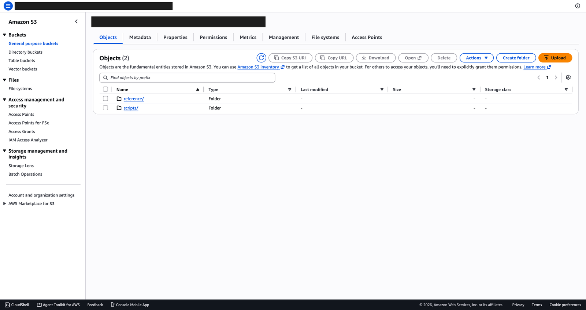

**Who gets the emails:** two confirmed subscriptions, each with a filter policy by entity (AP Mexico, AP USA).
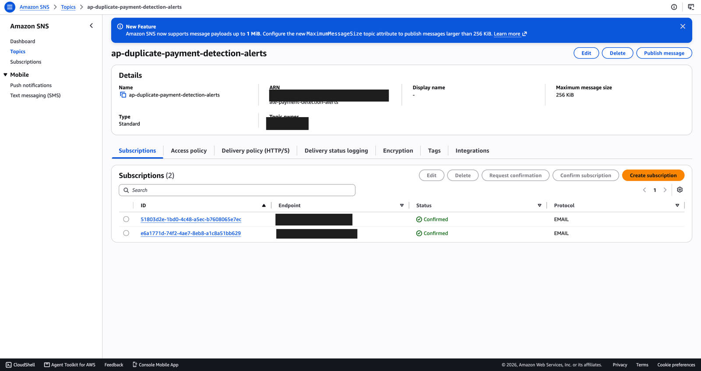

Nothing is delivered until the person confirms; this is the confirmation email and the page after clicking it.
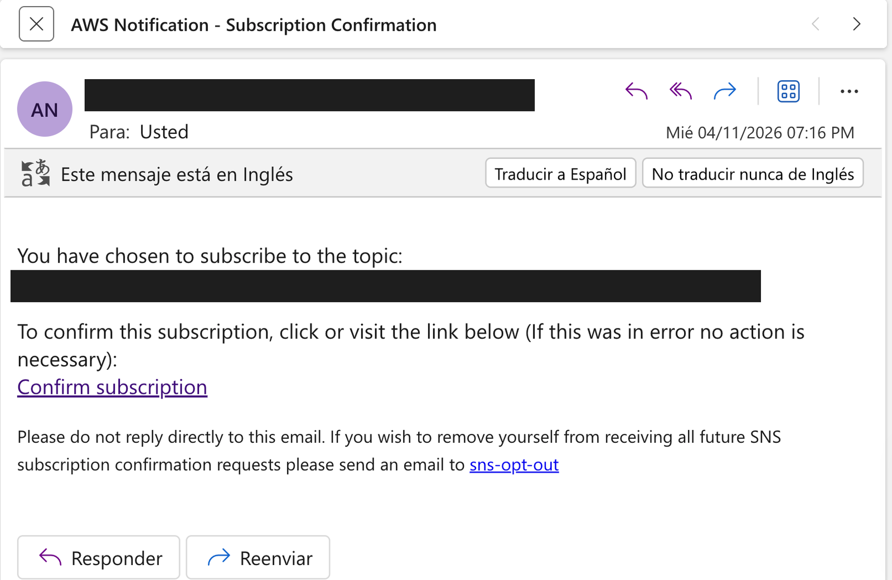
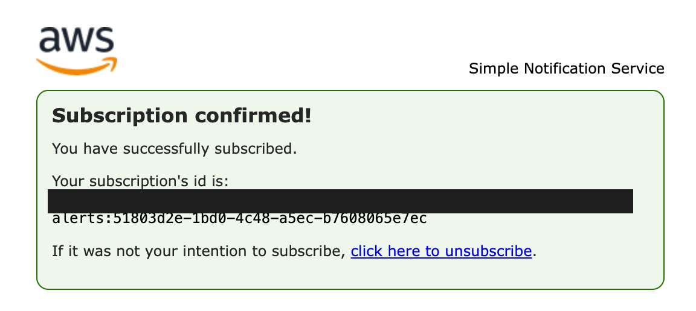

## 2. 128 ERP files validated as they landed

**Lambda Monitor after the history load:**
- 132 invocations, 100% success;
- **259 throttles**: this account allows only 10 concurrent Lambdas;
- **0 dropped events**: the asynchronous S3 trigger retried every throttled event ([lesson 2](../lessons-learned.md)).

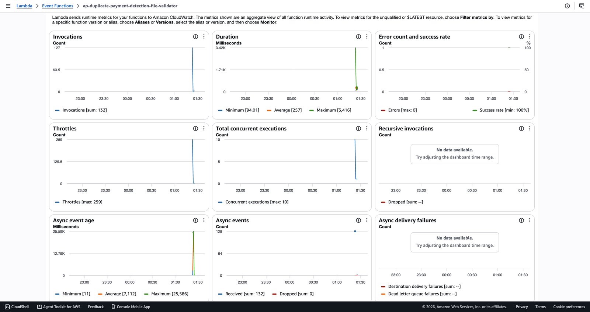

**The validated zone:** one folder per payment date, one file per entity and day.
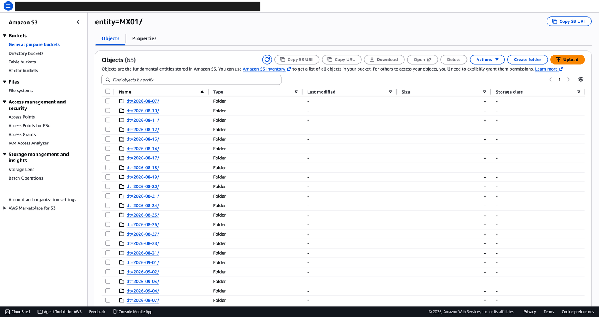
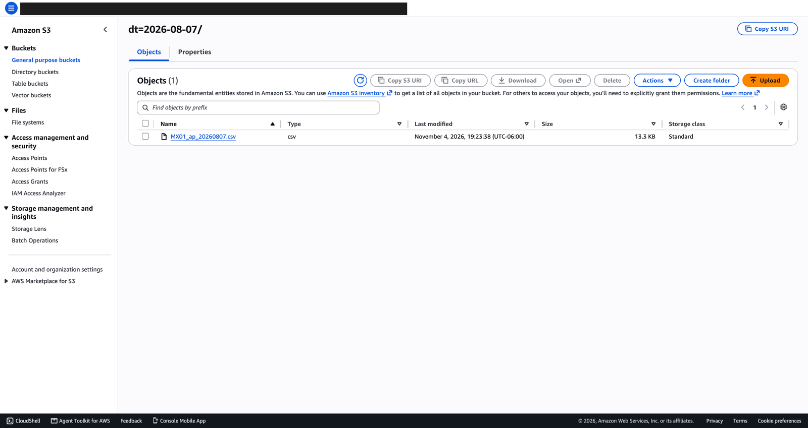

## 3. The live demo: a hand-edited file is rejected in seconds

One amount in the MX01 file was changed by hand after export. The control trailer no longer matched (`TRAILER_TOTAL_MISMATCH`: exactly the $1,000 added). The file was refused and AP Mexico was emailed. The correct file was accepted right after, and the same file sent again was ignored.
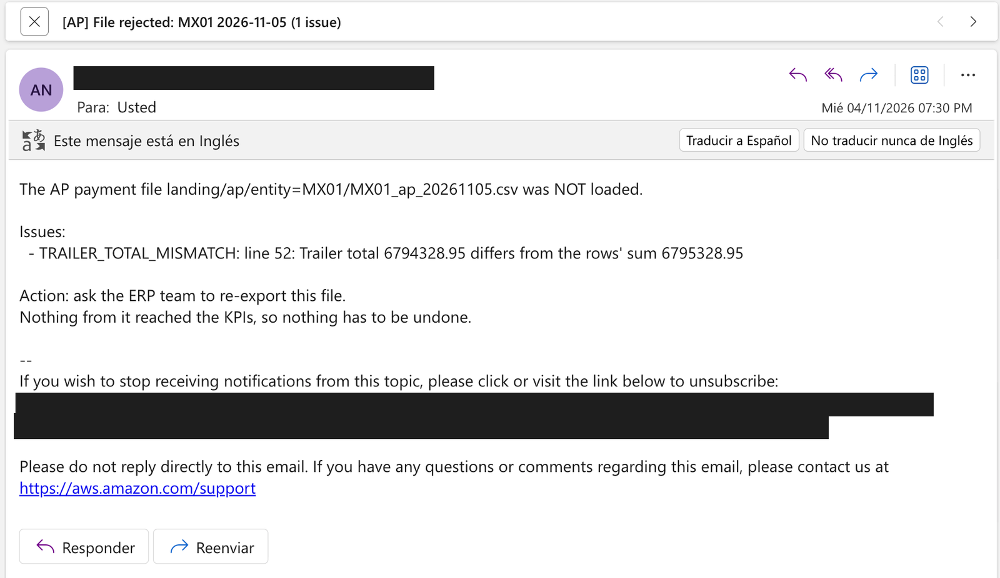

## 4. The daily Glue job: duplicates, KPIs, Data Quality

**The run:** SUCCEEDED in 2 min 44 s, on 2 G.1X workers (0.09 DPU-hours).
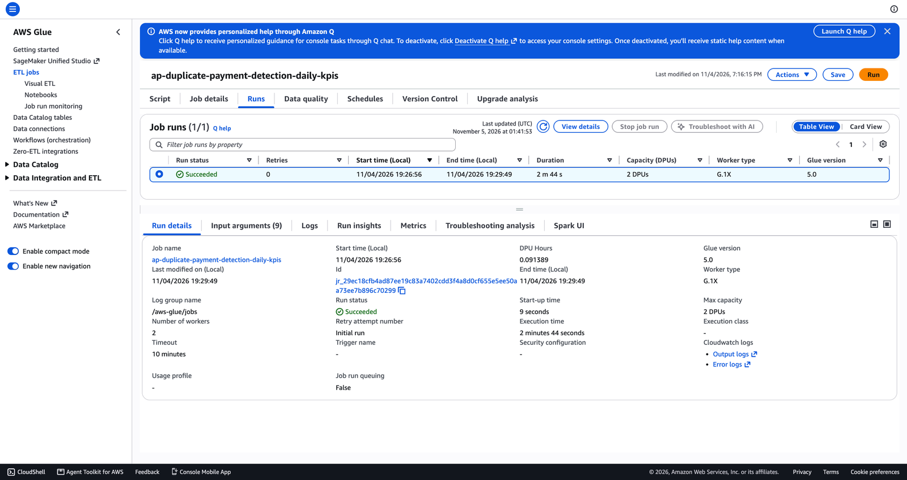

**Its arguments**, all from `config/settings.yaml`: the 7-day resubmission window, the overpayment tolerance, the validated zone as input.
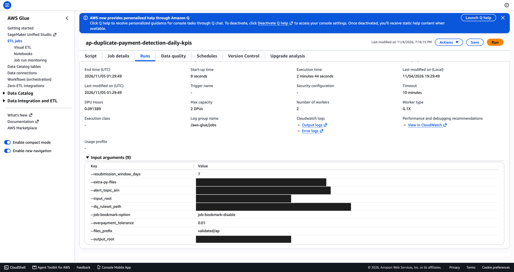

**Glue Data Quality:** the DQDL ruleset versioned in the repo (`dq/curated_payments.dqdl`) ran for the first time here and **passed all 11 rules**.
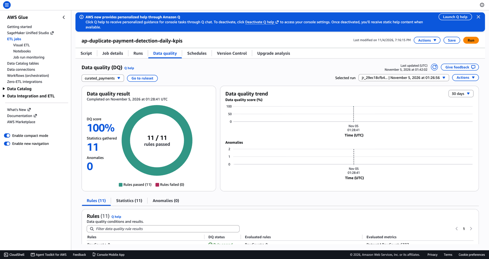
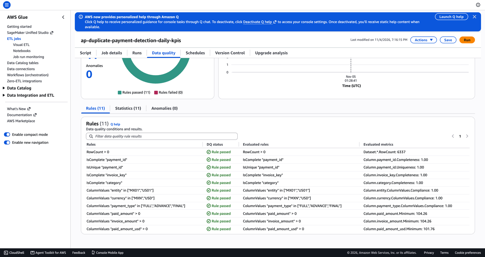

## 5. The result: the AP analyst's review list in Athena

`sql/02_duplicate_review_list.sql` on the real gold table returns **27 suspects**: proven overpayments (HIGH) first, biggest amount first. Graded against the simulator's answer key: **27 of 27 found, 0 false alarms, $195,416 at risk**.
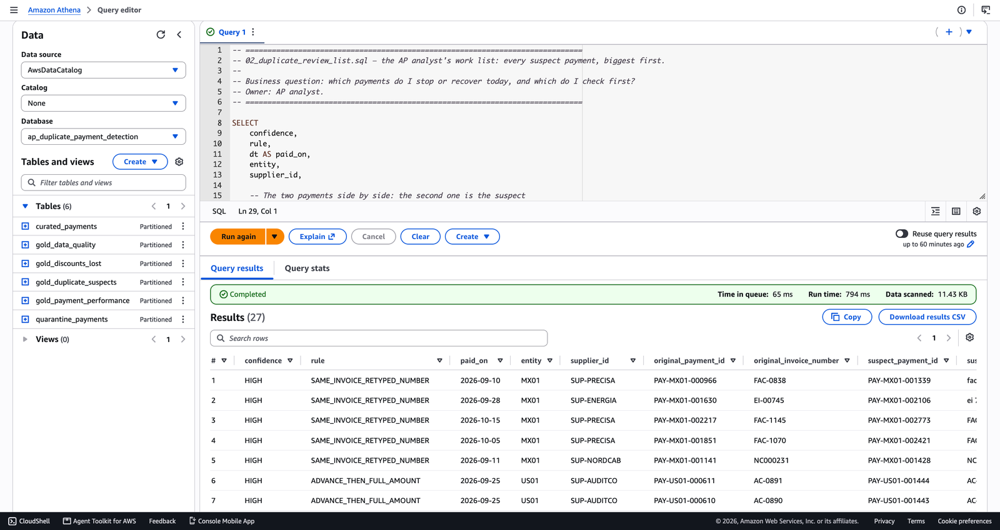

## 6. Everything deleted

`terraform destroy` removed the 30 resources. `make leftovers` checks the `Project` tag, every resource name, and the services that bill by the hour; it reported `✅ Nothing billable left.` See [destroyed/leftovers.txt](destroyed/leftovers.txt).
